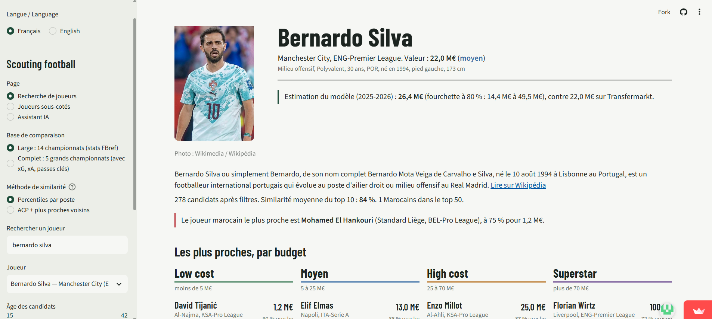
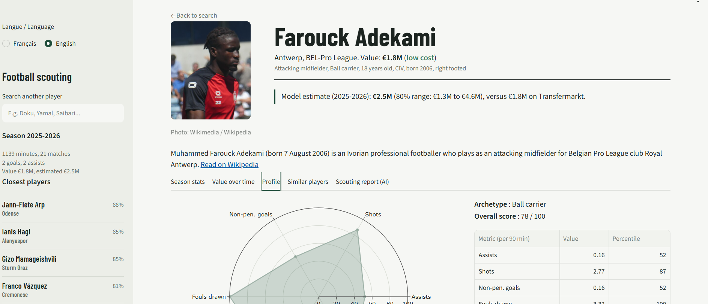
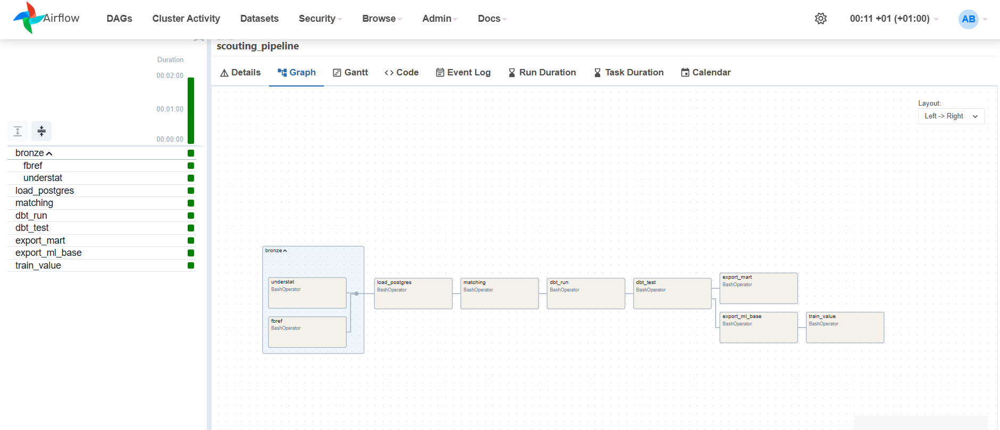
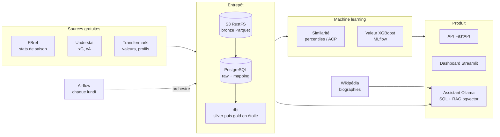

# Scouting football : de la donnée brute à l'assistant IA


Plateforme de scouting construite uniquement avec des données gratuites : elle trouve les joueurs au profil
le plus proche d'un joueur de référence, classés par budget, estime leur valeur marchande, repère les joueurs
sous-cotés et répond en langage naturel aux questions d'un recruteur. Focus sur les **joueurs marocains**.

Le projet couvre toute la chaîne d'un data / IA engineer : ingestion, entrepôt en couches, modélisation dbt,
machine learning suivi dans MLflow, API, dashboard, assistant LLM local avec RAG, orchestration et CI.

<!-- Captures à ajouter à la fin du projet (docs/img/) :




-->

## En bref

| | |
|---|---|
| Données | 14 championnats, saisons 2021-22 à 2025-26, FBref + Understat + Transfermarkt, 195 joueurs marocains |
| Entrepôt | S3 (bronze Parquet) → PostgreSQL → dbt (silver, gold en étoile), tests de qualité |
| ML | similarité par percentiles et ACP, valeur marchande XGBoost (MLflow), joueurs sous-cotés |
| Produit | dashboard Streamlit bilingue, API FastAPI, assistant IA local (Ollama) |
| Assistant | texte vers SQL **28 / 30** justes (10 / 10 sur des questions jamais vues), RAG Wikipédia sur pgvector |
| Industrialisation | Docker Compose, DAG Airflow hebdomadaire, GitHub Actions (lint, tests, dbt, image) |

## Architecture



| Couche | Où | Contenu |
|---|---|---|
| bronze | S3 (Parquet) | données brutes par source, saison et championnat ; clé fixe, donc ré-exécution sans doublon |
| raw | PostgreSQL `raw` | bronze chargé tel quel |
| mapping | PostgreSQL `mapping` | rapprochement des identifiants entre FBref, Understat et Transfermarkt |
| silver | PostgreSQL `silver` | nettoyage, typage, dédoublonnage, regroupement des transferts en cours de saison |
| gold | PostgreSQL `gold` | schéma en étoile (`dim_player`, `fact_player_season`, `fact_valuation`...) et `mart_scouting` |
| ml | PostgreSQL `ml` | valeurs prédites et fourchettes, lues par l'API, le dashboard et l'assistant |
| rag | PostgreSQL `rag` | passages de biographies et vecteurs `bge-m3` (pgvector, index HNSW) |

## Fonctionnalités

**Dashboard** (Streamlit, français et anglais)
- Recherche d'un joueur, joueurs les plus proches au global et par tranche de budget, filtres âge et Marocains.
- Fiche joueur partageable (`?joueur=<id>`) : photo et biographie Wikipédia, statistiques de chaque saison,
  évolution de la valeur, estimation du modèle avec fourchette, radar de percentiles, joueurs similaires,
  rapport de scouting rédigé par l'IA.
- Page des joueurs sous-cotés, exportable en CSV.

**Similarité** : chaque statistique devient un percentile au sein du poste, la similarité est une distance entre
profils ramenée sur 100. Variante ACP + plus proches voisins. Les deux sont comparées sur un test objectif
(retrouver un même joueur d'une saison à l'autre, hit@k) dans `docs/similarite_comparaison.md` : l'ACP ne fait
pas mieux, les percentiles restent le défaut pour leur lisibilité.

**Valeur marchande** : XGBoost sur le logarithme de la valeur Transfermarkt de fin de saison, découpage
temporel strict (entraînement 2021-22 à 2023-24, validation 2024-25, test 2025-26 jamais vue), fourchette à 80 %
calculée sur les résidus, essais comparés dans MLflow. Sur la saison de test : R² = **R2_TEST**, erreur médiane
**ERREUR_TEST %**. Détail : `docs/modele_valeur_resultats.md`.
Un joueur est dit sous-coté si sa valeur réelle est sous la fourchette basse prédite (au moins 50 % d'écart,
900 minutes, 28 ans maximum, valeur d'au moins 500 k€).

**API** (FastAPI, Swagger sur `/docs`)

| Route | Rôle |
|---|---|
| `POST /predict-value` | valeur prédite et fourchette, pour un joueur connu ou des caractéristiques saisies |
| `GET /similar-players` | joueurs proches, au global et par tranche de budget |
| `GET /undervalued` | joueurs sous-cotés de la dernière saison |
| `GET /health` | état et métriques du modèle |

**Assistant IA** (Ollama en local, gratuit, aucune donnée envoyée à l'extérieur)

| Partie | Fonctionnement |
|---|---|
| Questions chiffrées | Le modèle (`qwen2.5:7b`) écrit une requête SQL sur le schéma gold. Elle est vérifiée par analyse syntaxique (`sqlglot` : une seule lecture, tables autorisées, mots interdits), puis exécutée en transaction **lecture seule** avec 10 s maximum. En cas d'erreur ou de résultat vide, l'erreur est renvoyée au modèle qui corrige (3 essais). La requête est toujours affichée. |
| Biographies (RAG) | Articles Wikipédia découpés en passages, vecteurs multilingues `bge-m3` dans pgvector. Si la question cite un joueur, la recherche se limite à sa biographie. Réponse avec sources numérotées. |
| Rapport de scouting | 8 sections rédigées à partir de faits calculés par le projet ; chaque nombre du rapport est comparé aux faits et les nombres inventés sont signalés. |

Évaluation sur 30 questions avec requête de référence écrite à la main (`docs/assistant_evaluation.md`) :
18 / 20 sur les questions utilisées pour ajuster le prompt, **10 / 10 sur 10 questions écrites après**, qui
mesurent honnêtement la généralisation.

**Orchestration** : le DAG Airflow `scouting_pipeline` enchaîne collecte, chargement, rapprochement, `dbt run`,
`dbt test`, exports et réentraînement chaque lundi. Deux reprises par tâche ; si `dbt test` échoue, rien n'est
exporté et le dashboard garde les dernières données valides.

**Qualité** : tests dbt (unicité, volumes, valeurs plausibles, couverture des sources), tests pytest (API, agent SQL,
RAG, rapports, DAG), lint `ruff`, et GitHub Actions qui vérifie à chaque push le lint, les tests, la compilation dbt
et le build de l'image de l'API.

**Exploration** : `notebooks/01_exploration.ipynb` (qualité des données, valeur selon l'âge, joueurs marocains,
lien performance-valeur par poste, biais du modèle) et 10 requêtes SQL d'analyse dans `analyses/`.

## Démarrage rapide

Prérequis : Python 3.12, Docker Desktop, et [Ollama](https://ollama.com) pour l'assistant.

```powershell
git clone https://github.com/anasshameddine/football-scouting.git
cd football-scouting
python -m venv venv ; .\venv\Scripts\Activate.ps1
pip install -r requirements.txt
copy .env.example .env
docker compose up -d                          # PostgreSQL (pgvector) + stockage S3
```

Remplir les données puis lancer le dashboard :

```powershell
python ingestion\bronze_load.py               # fichiers locaux (dont Transfermarkt) -> bronze
python ingestion\collect_bronze.py --source fbref --saisons 2025-2026
python ingestion\collect_bronze.py --source understat --saisons 2025-2026
.\run_pipeline.ps1                            # bronze -> PostgreSQL -> dbt -> exports -> modèle
python -m streamlit run app\app.py
```

Assistant :

```powershell
ollama pull qwen2.5:7b ; ollama pull bge-m3   # une fois, environ 6 Go
python -m assistant.rag --limite 500          # indexer les biographies (Marocains d'abord)
python -m assistant.evaluer                   # précision de l'agent SQL
```

Autres services :

```powershell
python -m uvicorn api.main:app --reload                    # API : http://localhost:8000/docs
docker compose --profile airflow up -d --build             # Airflow : http://localhost:8080 (admin / admin)
mlflow ui --backend-store-uri sqlite:///mlflow.db          # suivi des essais du modèle
python -m pytest -q ; ruff check .                         # tests et lint
```

## Choix techniques

| Choix | Pourquoi |
|---|---|
| Bronze en Parquet sur S3 | garder la donnée brute rejouable : une erreur de nettoyage se corrige sans recollecter |
| dbt + schéma en étoile | transformations versionnées, testées et documentées ; requêtes d'analyse simples |
| Percentiles par poste pour la similarité | lisibles par un recruteur, robustes aux valeurs extrêmes ; l'ACP n'a pas fait mieux au test |
| Log de la valeur et découpage temporel | la valeur est très concentrée ; tester sur une saison future évite toute fuite d'information |
| LLM local (Ollama) | gratuit, données privées, reproductible sans clé d'API |
| SQL généré vérifié + lecture seule | un modèle de 7B se trompe : la sécurité ne repose pas sur lui |
| Vérification des nombres du rapport | rend visibles les hallucinations au lieu de les cacher |
| Deux scores pour l'assistant | un prompt ajusté sur ses questions de test surestime sa précision ; les 10 questions écrites après mesurent la vraie |
| Airflow en SQLite / SequentialExecutor | suffisant pour un pipeline hebdomadaire sur un poste ; à passer en PostgreSQL / LocalExecutor en production |

## Limites

- **Valeur Transfermarkt** : estimation communautaire, arrondie par paliers ; ce n'est pas un prix de transfert.
- **Modèle de valeur** : il sous-estime nettement les joueurs au-dessus de 50 M€ (notoriété, prestige du club,
  contrat ne sont pas dans les statistiques). Un avertissement est affiché au-dessus de ce seuil.
- **Fin de contrat** : connue seulement pour la saison en cours, donc absente du modèle.
- **Couverture** : 14 championnats ; les joueurs marocains des championnats non couverts (Botola, Golfe...) n'y sont pas.
  Les xG n'existent que pour les 5 grands championnats.
- **Rapprochement des sources** : par nom, année de naissance et club ; des homonymes dans un même championnat restent possibles.
- **Assistant** : un modèle de 7B reste instable sur les questions complexes (2 erreurs sur 30) ; 35 joueurs marocains
  sur 195 n'ont pas de biographie trouvée sur Wikipédia.
- **StatsBomb Open Data** : exploré (`docs/statsbomb_exploration.md`) mais non intégré : 3 tournois du Maroc seulement
  et 22 joueurs sur 107 en commun avec la base.

## Améliorations possibles

- Variables de prestige (valeur moyenne du club, coupes d'Europe, sélections) pour corriger les hautes valeurs.
- Données d'événements (StatsBomb, Wyscout) pour des profils plus fins que les statistiques de saison.
- Ajout de la Botola Pro et des championnats du Golfe.
- Déploiement du dashboard (Streamlit Community Cloud) et de l'API, Airflow sur PostgreSQL.

## Structure du dépôt

| Dossier | Rôle |
|---|---|
| `ingestion/` | collecte des sources, chargement PostgreSQL, rapprochement des identifiants |
| `dbt/` | modèles staging, intermediate, gold et tests |
| `ml/` | similarité, modèle de valeur, exports |
| `api/` | API FastAPI et ses tests |
| `app/` | dashboard Streamlit |
| `assistant/` | agent texte vers SQL, RAG, rapports, évaluation |
| `airflow/` | DAG et image Docker |
| `analyses/` | 10 requêtes SQL d'analyse (fonctions de fenêtre, percentiles, régression) |
| `notebooks/` | notebook d'exploration des données |
| `docs/` | résultats des modèles, évaluations, notes sur les sources |

## Sources et licences

- [FBref](https://fbref.com) et [Understat](https://understat.com) via [soccerdata](https://github.com/probberechts/soccerdata),
  [Transfermarkt](https://www.transfermarkt.com) (valeurs et profils), [Wikipédia](https://www.wikipedia.org)
  (API publique, textes sous licence CC BY-SA).
- [StatsBomb Open Data](https://github.com/statsbomb/open-data) pour l'exploration : données fournies par StatsBomb.
- Usage personnel et pédagogique, sans but commercial. Code sous licence MIT.

---

Projet réalisé par **Anass Hameddine**, élève ingénieur en IA et Data à l'EMSI.
